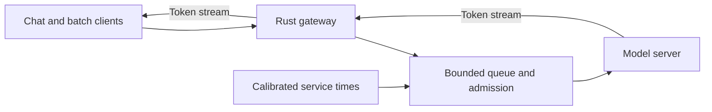

# Inference Gateway

[](https://github.com/ysham123/inference-gateway/actions/workflows/checks.yml)

A Rust gateway for serving interactive chat and batch jobs on the same local LLM. It streams OpenAI-style chat completions, limits the waiting queue, and uses measured request times to decide when batch work can use the last idle model slot.

[Quick start](#quick-start) · [How it works](#how-it-works) · [Evaluation guide](benchmarks/adaptive.md) · [Raw results and chart](benchmarks/results/adaptive-m2-pro/)

## Benchmark

In three paired short-batch runs on an **Apple M2 Pro** with **Llama 3.2 3B Instruct** and llama.cpp, adaptive admission met both chat latency targets for **24 of 24 requests in each run**. The targets were 4 seconds to first text and 150 ms per output token.

| Policy | Chat requests meeting both targets | Batch output tokens/s |
| --- | --- | ---: |
| Fixed reservation | 21/24, 11/24, 15/24 | 6.79–7.38 |
| Adaptive admission | 24/24, 24/24, 24/24 | 6.42–7.54 |

Adaptive batch throughput was lower in two runs. At the tighter 1.4-second first-token budget, adaptive admission borrowed zero slots. These results use synthetic traffic on one CPU backend. The [evaluation guide](benchmarks/adaptive.md) also includes the setup for a native vLLM comparison on CUDA.

## How it works



A request holds its slot while the model streams. If the client disconnects, the gateway drops the upstream response and releases the slot. A full queue returns HTTP 503. The response header `X-Queue-Wait-Ms` records wait time before admission. Adaptive dispatches that borrowed capacity carry `X-Admission-Borrowed: 1`.

| Policy | Admission rule |
| --- | --- |
| `fifo` | Dispatch waiting requests in arrival order. |
| `weighted` | Give chat up to three turns before a batch turn when both classes can run. |
| `reserved` | Keep one of the active slots for chat. |
| `adaptive` | Allow batch to use the last idle slot when a profiled completion estimate leaves enough time for chat to start within budget. A waiting chat request or a missing or overdue estimate preserves the slot. |

## Quick start

You’ll need Rust and Cargo, `llama-server`, and a local GGUF model. Start the model server in one terminal.

```sh
llama-server --model /path/to/model.gguf --alias local-model \
  --host 127.0.0.1 --port 8081 --parallel 2
```

Start the gateway from the repo root in a second terminal.

```sh
cargo run --locked
```

Send an interactive request from a third terminal. Add the header `X-Request-Class: batch` to send batch work.

```sh
curl --no-buffer http://127.0.0.1:8080/v1/chat/completions \
  -H 'Content-Type: application/json' \
  -d '{"model":"local-model","messages":[{"role":"user","content":"What does an inference gateway do?"}],"stream":true,"max_tokens":40}'
```

You should see `data:` events as text arrives, followed by `data: [DONE]`. The gateway’s `/health` endpoint returns HTTP 204.

| Environment variable | Default | Purpose |
| --- | --- | --- |
| `GATEWAY_ADDR` | `127.0.0.1:8080` | Local gateway address. |
| `MODEL_SERVER_URL` | `http://127.0.0.1:8081` | Origin of the HTTP model server. Use port 11434 for local Ollama. |
| `MAX_ACTIVE_REQUESTS` | `2` | Maximum active gateway requests. Match the model server’s configured parallel capacity. |
| `MAX_QUEUED_REQUESTS` | `32` | Maximum waiting requests. Set to zero to skip waiting. |
| `SCHEDULING_POLICY` | `fifo` | `fifo`, `weighted`, `reserved`, or `adaptive`. |
| `ADMISSION_PROFILE` and `CHAT_TTFT_MS` | Required for `adaptive` | Calibration JSON path and chat first-token budget in milliseconds. |

Follow the [evaluation guide](benchmarks/adaptive.md) to generate a profile and reproduce the adaptive comparison. The [original FIFO benchmark](benchmarks/README.md) has the setup for the earlier burst experiments.

## Tests

```sh
cargo test --locked
python3 -m unittest discover -s benchmarks
```

The tests cover queue overflow, cancellation, weighted ordering, fixed and adaptive reservation, and benchmark accounting. They run without model weights.
