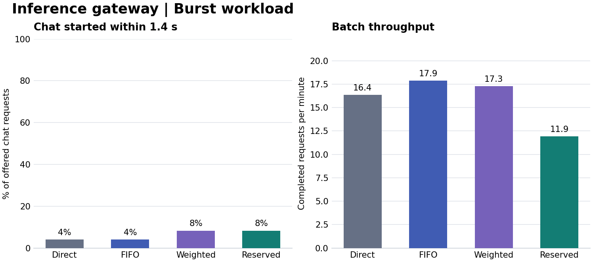

# Inference gateway benchmark

The burst scenario sends 24 interactive requests in four bursts while 12 batch requests arrive roughly once a second. Interactive requests generate up to 12 tokens and batch requests up to 96. The client schedules arrivals independently of earlier completions.

## Pilot results

Apple M2 Pro, 16 GiB memory, CPU inference with four threads, llama.cpp build b12756, Llama 3.2 3B Instruct Q4_K_M. The server had two model slots. Each gateway policy allowed two active and 16 waiting requests. The direct run used the model server's queue. After warming the model, the solo run measured 470 ms p95 time to first token. The target of 1.4 s was fixed before the mixed-load runs.



| Policy | Chat within 1.4 s | Chat completed | Chat p95 first token | Batch completed | Batch requests/min |
| --- | ---: | ---: | ---: | ---: | ---: |
| Direct | 1/24 | 24/24 | 32.2 s | 12/12 | 16.4 |
| FIFO | 1/24 | 14/24 | 28.2 s | 12/12 | 17.9 |
| Weighted | 2/24 | 15/24 | 13.2 s | 11/12 | 17.3 |
| Reserved | 2/24 | 18/24 | 7.3 s | 12/12 | 11.9 |

Weighted scheduling moved chat forward in the queue. Reservation kept batch from occupying both slots and gave chat the lowest p95 among successful streams. It completed three more chat requests than weighted scheduling and achieved the same deadline attainment. Each policy fell short of the 95% chat goal at this arrival rate. The completion counts belong alongside p95 because p95 covers only successful streams.

Under batch-only load, both policies completed all eight requests. Weighted scheduling finished at 23.5 batch requests/min and reservation at 20.2, about 14% lower. In a separate disconnect check, the model server's `/slots` endpoint showed one busy slot before the client disconnected and zero by the next 50 ms poll.

These are single runs with synthetic traffic on one CPU backend. Batch rates include queue drain time. The raw request records include completion status, time to first text, gateway wait time when available, and actual launch delay.

## Reproduce the comparison

Run a local GGUF of Llama 3.2 3B Instruct with the same serving parameters.

```sh
llama-server --model /path/to/model.gguf --alias local-model --host 127.0.0.1 \
  --port 8081 --device none --n-gpu-layers 0 --ctx-size 1536 --parallel 2 --threads 4
```

Warm the model with a short request. From the repository root, run the solo calibration and direct baseline.

```sh
python3 benchmarks/replay.py --url http://127.0.0.1:8081/v1/chat/completions \
  --label direct --scenario solo --output /tmp/direct-solo.json
python3 benchmarks/replay.py --url http://127.0.0.1:8081/v1/chat/completions \
  --label direct --scenario burst --deadline-ms 1400 --output /tmp/direct-burst.json
```

Start the gateway in another terminal. Use `fifo`, `weighted`, or `reserved` for `POLICY`, restarting between runs.

```sh
SCHEDULING_POLICY="$POLICY" MAX_ACTIVE_REQUESTS=2 MAX_QUEUED_REQUESTS=16 cargo run --locked
```

Replay the same arrivals for each policy.

```sh
python3 benchmarks/replay.py --label "$POLICY" --scenario burst --deadline-ms 1400 \
  --output "/tmp/${POLICY}-burst.json"
```

For the batch-only replay, use the same gateway settings with weighted and reserved scheduling.

```sh
python3 benchmarks/replay.py --label "$POLICY" --scenario batch-only \
  --output "/tmp/${POLICY}-batch-only.json"
```

With Matplotlib installed, regenerate the chart from the [published reports](results/m2-pro/).

```sh
python3 benchmarks/plot.py benchmarks/results/m2-pro/{direct,fifo,weighted,reserved}-burst.json \
  --output /tmp/inference-gateway-burst.png
```
