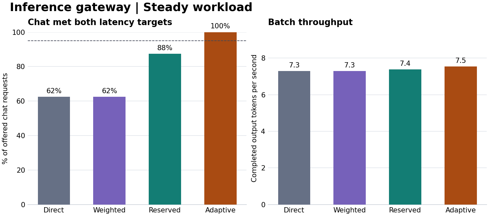

# Adaptive admission pilot

Apple M2 Pro with 16 GiB RAM, Llama 3.2 3B Instruct Q4_K_M on CPU, llama.cpp b12756, four threads, two backend slots and 16 waiting requests at the gateway. The joint chat target used 150 ms per output token in every run. A steady workload offered 24 chat and six batch requests per run. The two heavier tests used the earlier 1.4 s chat startup budget. The short-batch experiment used 4 s to leave room for a profiled 24-token batch request to finish within the budget.

The calibrated chat startup allowance was 1.349 s. The first two cases therefore left only 51 ms to wait for a slot. The 4 s budget left 2.651 s. Throughput includes time to drain the queue.

## Steady load, 96-token batch cap, 1.4s target

| Policy | Chat within both targets | Batch output tokens/s | Borrowed dispatches |
| --- | ---: | ---: | ---: |
| reserved | 1/24 | 17.2 | 0 |
| adaptive | 3/24 | 18.3 | 0 |
| weighted | 3/24 | 18.1 | 0 |

## Double the chat arrival rate, 96-token batch cap, 1.4s target

| Policy | Chat within both targets | Batch output tokens/s | Borrowed dispatches |
| --- | ---: | ---: | ---: |
| reserved | 2/24 | 15.9 | 0 |
| adaptive | 1/24 | 16.9 | 0 |
| weighted | 1/24 | 21.3 | 0 |

## Steady load, 24-token batch cap, 4s target

| Policy | Chat within both targets | Batch output tokens/s | Borrowed dispatches |
| --- | ---: | ---: | ---: |
| direct | 15/24 | 7.3 | 0 |
| weighted | 15/24 | 7.3 | 0 |
| reserved | 21/24 | 7.4 | 0 |
| adaptive | 24/24 | 7.5 | 5 |

## Findings

The adaptive policy recorded no borrowed dispatches in either 1.4 s workload. At that budget it protected the last idle slot. Fixed reservation caps batch concurrency and can start batch work alongside an active chat request.
In the 4 s short-batch workload it borrowed capacity for 5 of six batch requests.
Adaptive and fixed reservation recorded 100% and 88% joint chat attainment. Their batch rates were 7.5 and 7.4 output tokens/s, respectively.

See the [evaluation guide](../../adaptive.md) for calibration and sweep commands.

Each row is a single run on this CPU backend with synthetic requests. The loads and targets vary between groups. The results describe those test conditions. The CUDA and native vLLM priority comparison is pending.

## Short-batch repeat runs

The chart shows the first run. Two additional pairs used the same workload and budgets, with policy order reversed between the two pairs.

| Run | Adaptive chat hits | Reserved chat hits | Adaptive batch tokens/s | Reserved batch tokens/s |
| --- | ---: | ---: | ---: | ---: |
| 1 | 24/24 | 21/24 | 7.54 | 7.38 |
| 2 | 24/24 | 11/24 | 6.42 | 6.79 |
| 3 | 24/24 | 15/24 | 6.58 | 7.01 |

- Adaptive met the 95% chat target in 3 of three runs, with 6.42–7.54 batch output tokens/s.
- Reserved met the 95% chat target in 0 of three runs, with 6.79–7.38 batch output tokens/s.
